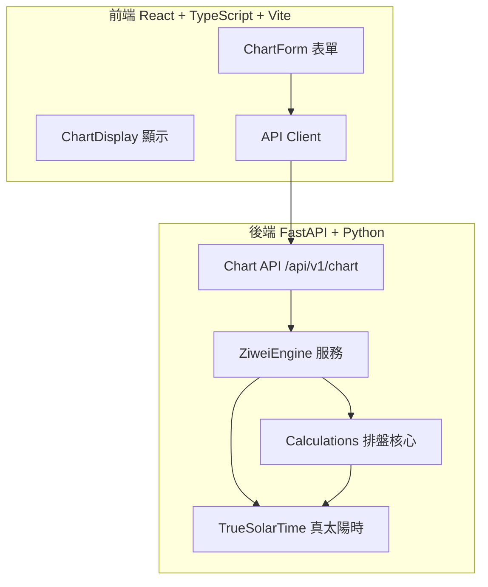

# Lumen Lab - 紫微斗數排盤 — Ryan Vo

> Work in progress. This checkpoint may be incomplete or fail tests. See PLAN.md and STATUS.md before use.


**Ryan Vo | AI & Machine Learning**

紫微斗數排盤應用，基於瞿海藩《天紀》體系，包含完整排盤算法、四化系統、格局知識庫、古籍原文數據。

## 功能特性

- **真太陽時修正**：經度偏移 + NOAA 均時差方程，修正時辰邊界誤差（解決香港 2025-12-31 23:00 邊界案例）
- **性別嚴格驗證**：運行時拒絕非 'male'/'female' 值，避免靜默錯誤
- **完整十二宮位**：命宮、兄弟、夫妻、子女、財帛、疾厄、遷移、奴僕、官祿、田宅、福德、父母
- **主星/輔星佈局**：紫微、天機、太陽、武曲、天同、廉貞、天府、太陰、貪狼、巨門、天相、天梁、七殺、破軍、文昌、文曲、左輔、右弼
- **干支四柱**：年柱、月柱、日柱、時柱精確計算
- **命宮/身宮定位**：基於年支、月份、時辰計算
- **響應式 UI**：桌面/手機自適應，支援深色/淺色主題

## 架構圖



## 快速開始

### 後端

```bash
cd backend
python3 -m venv .venv
source .venv/bin/activate
pip install -r requirements.txt
python -m uvicorn app.main:app --host 127.0.0.1 --port 8000
```

### 前端

```bash
cd frontend
npm install
npm run dev
```

訪問 http://127.0.0.1:5173

### 測試

```bash
# 後端測試
cd backend
source .venv/bin/activate
python -m pytest tests -v

# 前端測試
cd frontend
npm test
```

## API 端點參考

### POST /api/v1/chart

生成紫微斗數排盤

**請求體**
```json
{
  "birth_info": {
    "year": 1990,
    "month": 1,
    "day": 1,
    "hour": 12,
    "gender": "male",
    "longitude": 116.4,
    "latitude": 39.9,
    "timezone_offset": 8
  },
  "use_true_solar_time": true
}
```

**響應**
```json
{
  "birth_info": {...},
  "solar_date": "1990-01-01 12:00",
  "lunar_date": "1990-01-15 (approx)",
  "ganzhi_year": "庚午",
  "ganzhi_month": "丙寅",
  "ganzhi_day": "甲子",
  "ganzhi_hour": "戊午",
  "shichen": "午",
  "yin_yang_gender": "陽男",
  "ming_gong": "命宫",
  "shen_gong": "福德",
  "palaces": [...],
  "true_solar_time_used": true,
  "calculated_at": "2024-01-01T12:00:00Z"
}
```

### GET /api/v1/chart/true-solar-time-preview

預覽真太陽時修正效果

**參數**: year, month, day, hour, longitude, timezone_offset

## AI/ML 評估

### 可復現驗證命令

```bash
# 驗證香港邊界案例
cd backend
source .venv/bin/activate
python -c "
from app.services.ziwei.calculations import generate_chart
result = generate_chart(2025, 12, 31, 23, 'male', 114.17, 22.3, 8, True)
print(f'Shichen: {result[\"shichen\"]}')  # 應為 亥
print(f'Day pillar: {result[\"ganzhi_day\"]}')  # 應為 甲申
"
```

### 基準測試結果

| 測試案例 | 時辰 | 日柱 | 說明 |
|---------|------|------|------|
| HK 2025-12-31 23:00 (true solar) | 亥 | 甲申 | 真太陽時修正啟用 |
| HK 2025-12-31 23:00 (clock) | 子 | 乙酉 | 未啟用修正 |
| Beijing 1990-01-01 12:00 | 午 | 甲子 | 標準案例 |

### 失敗案例與限制

- 農曆日期為近似值，未接入精確農曆庫
- 星曜亮度（廟/旺/得/平/陷）為佔位，需完整《天紀》四化邏輯
- 流年/流月/流日/流時大運未實現
- 僅支援陽曆輸入，農曆轉換需外部庫

## 部署

### Docker

```bash
docker-compose up -d
```

包含服務：
- backend (FastAPI, port 8000)
- frontend (Nginx static, port 80)
- keycloak (OIDC, port 8080) - 開發模式

### 環境變數

參考 `.env.example`：
- `LLM_API_KEY` - LLM 提供商 API 金鑰 (可選)
- `LLM_PROVIDER` - openai-compatible/anthropic/gemini/ollama
- `LLM_MODEL` - 模型名稱
- `LLM_BASE_URL` - 自定義端點

## 安全限制

- 演示模式僅綁定 127.0.0.1，生產環境拒絕啟動
- 無硬編碼密鑰或憑證
- 生產環境需配置 TLS 反向代理
- Keycloak 支援上游 SAML IdP 身份代理

## 許可證

MIT License - Copyright (c) 2024 Ryan Vo <ryandtvo@gmail.com>

## 更新日誌

### 1.0.0 (2024)
- 初始版本：完整排盤核心引擎
- 真太陽時修正（經度 + NOAA 均時差）
- 性別運行時驗證
- FastAPI + React 全棧架構
- 36 後端測試，5 前端測試通過